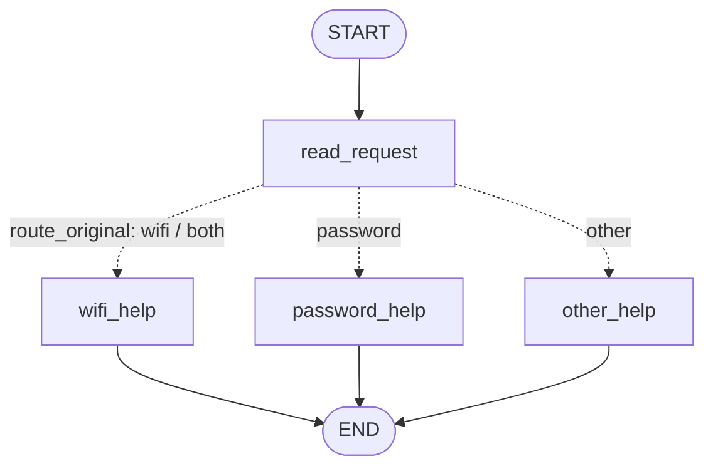
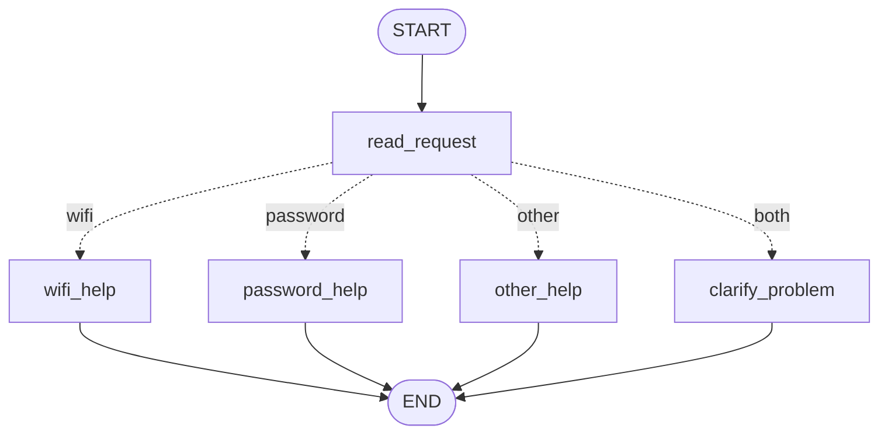
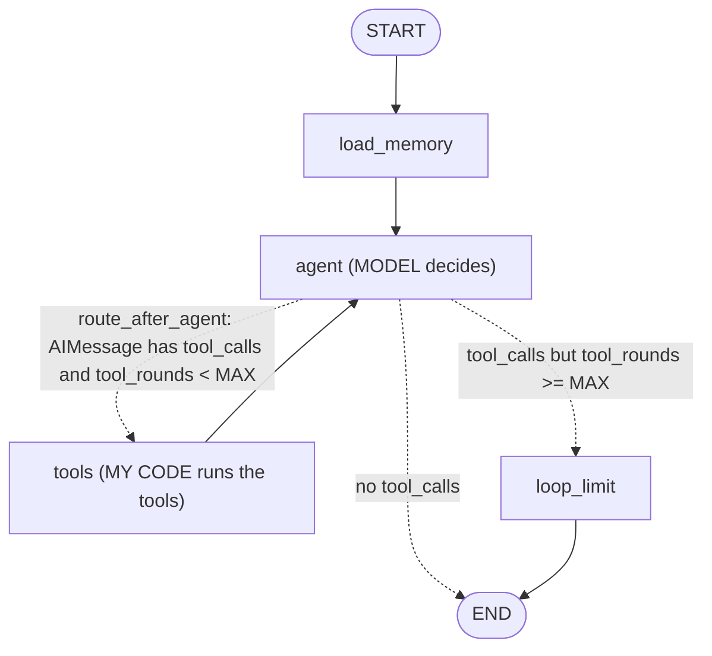

# HW5 — My LangGraph helpdesk

> **Logs.** `outputs/openai/` — real runs with **OpenAI gpt-4.1-mini** (run on Windows, Python 3.11).
> `outputs/openai/before-prompt-fix/` — the first real S08/S12 runs that behaved wrongly (kept as evidence).
> `outputs/fake/` — a clearly labelled FAKE rule-based model used for tests/CI, **not an LLM**.
> `outputs/part1/` — Part 1 (no model).

## Part 1 — How the graph works

### My graph and state

Code: `helpdesk/part1.py`. State (`HelpdeskState`):

| Field | Written by | Meaning |
| --- | --- | --- |
| `message` | input | the user's original message (never changed) |
| `category` | `read_request` | `wifi`, `password`, `both` or `other` |
| `reply` | one help node | the response text |

| Node | Reads | Changes |
| --- | --- | --- |
| `read_request` | `message` | sets `category` (lower-cases the text, looks for `wifi`/`wi-fi` and `password`) |
| `wifi_help` | `data/helpdesk.json` → `instructions.wifi` | sets `reply` |
| `password_help` | `data/helpdesk.json` → `instructions.password` | sets `reply` |
| `other_help` | nothing | sets `reply` to a question: Wi-Fi or password? |
| `route_original` (conditional edge, not a node) | `category` | nothing — it only returns the name of the next node |

**Answers to the four questions**

1. *What does each node read and change?* See the table. Each node returns only the keys it changes (a partial update); LangGraph merges that update into the state.
2. *Node update vs conditional edge.* A node does work and returns a **state update** (`{"category": "wifi"}`). A conditional edge is a routing function that reads the state and returns the **name of the next node**; it does not change the state. In my code `read_request` decides *what the category is*, `route_original` decides *where to go*.
3. *What does the next node receive?* The **whole current state** after merging, not just the previous update. `wifi_help` could read `message` even though `read_request` only returned `category` (see the `state_after` column in the logs).
4. *START, END, compile.* `START` is the virtual entry point (the edge `START → read_request` says where execution begins); `END` is the virtual exit — reaching it stops the run and returns the final state. `compile()` checks the graph structure (all nodes reachable, edges valid) and turns the builder into a runnable object with `invoke`/`stream`.

### Predictions before running

| Message | Predicted route | Actual route | What I learned |
| --- | --- | --- | --- |
| I cannot connect to Wi-Fi. | read_request → wifi_help | START → read_request → wifi_help → END ([S01](outputs/part1/S01.md)) | `wi-fi` alias matches; `category=wifi` set by read_request, `reply` by wifi_help |
| I forgot my PASSWORD. | read_request → password_help | START → read_request → password_help → END ([S02](outputs/part1/S02.md)) | lower-casing makes `PASSWORD` match |
| My laptop screen is broken. | read_request → other_help | START → read_request → other_help → END ([S03](outputs/part1/S03.md)) | no keyword → fallback asks Wi-Fi or password |
| My Wi-Fi password does not work. | read_request → wifi_help | START → read_request → wifi_help → END ([S04](outputs/part1/S04.md)) | both topics present; the Wi-Fi rule is checked **first**, so the password part is silently ignored |

**Two topics in the original graph.** `read_request` sets `category="both"`, but
`route_original` follows the rule order of the brief: “if it contains wifi → wifi_help;
*otherwise* if it contains password → password_help”. Because the Wi-Fi rule comes
first, the message goes to `wifi_help` and the user gets Wi-Fi instructions even if
their real problem is the password.

### My change to the graph

New trace ([S05](outputs/part1/S05.md)), `python -m helpdesk.part1 --variant with_clarification "My Wi-Fi password does not work."`:

| Node | Update | State after node |
| --- | --- | --- |
| START | `{}` | `{"message": "My Wi-Fi password does not work."}` |
| read_request | `{"category": "both"}` | `{..., "category": "both"}` |
| clarify_problem | `{"reply": "Your message mentions both Wi-Fi and a password. Is the problem connecting to Wi-Fi, or recovering your account password? ..."}` | `{..., "category": "both", "reply": "..."}` |
| END | | |

The difference is structural: there is a new node and a new branch of the conditional
edge (`route_with_clarification` returns `clarify_problem` when `category == "both"`).
The help nodes are unchanged.

**What LangGraph controls vs what my functions decide.** LangGraph controls the
*execution*: it starts at `START`, calls nodes in the order the edges allow, merges
each returned update into the state, calls the routing function at the conditional edge
and jumps to the node it names, and stops at `END`. My Python functions make every
*decision*: keyword matching and category in `read_request`, the rule order in the
router, and the reply text. There is no model in Part 1, so the same message always
takes the same route.

## Part 2 — Model and tools

Code: `helpdesk/tools.py`, `helpdesk/agent.py`.
**Model and provider:** OpenAI `gpt-4.1-mini` (`MODEL_NAME` in `.env`), temperature 0, via `langchain-openai`.
Tests/CI use `FakeHelpdeskModel` (`helpdesk/fake_model.py`), a deterministic rule set labelled FAKE.

### The loop

1. **How does the graph choose between a tool and an answer?** After every `agent` call the conditional edge `route_after_agent` looks at the last message. If it is an `AIMessage` with `tool_calls`, it routes to `tools`; if it has no tool calls, it is the final answer and the route is `END`.
2. **Who requests and who executes?** The **model** only *requests* a tool (it outputs a tool name and JSON arguments). My `tools` node (`run_tools` in `agent.py`) looks up the tool by name, calls the Python function and wraps the result in a `ToolMessage`. The model never runs code, and it cannot choose the status snapshot, `user_id`, `thread_id` or ticket folder: those are bound by the application in `ToolContext`.
3. **What changes in the state after a tool result?** `messages` gets one `ToolMessage` per call (via the `add_messages` reducer, so it is appended, not replaced), linked by `tool_call_id`, and `tool_rounds` is incremented. The next `agent` call sees the full history including the results.
4. **Difference from Part 1.** In Part 1 the route was fixed by my keyword rules. Here the *model* chooses which tools to call, in what order and when to stop, based on the request and on the tool results; the graph structure only provides the loop. The same request can therefore take different paths when the data changes (S06/S07/S08).

**Loop limit.** `MAX_TOOL_ROUNDS = 4` (env `HELPDESK_MAX_TOOL_ROUNDS`). It is enforced in the
conditional edge `route_after_agent`: if the model asks for a tool when `tool_rounds` already
equals the limit, the graph goes to `loop_limit`, which answers that it stopped, writes
`loop_limit_reached=True`, and adds a "not executed" `ToolMessage` for each pending call so
the saved conversation stays valid for the next turn. `tool_rounds` is reset to 0 at the start
of each turn by `load_memory`. As a second safety net, LangGraph's `recursion_limit=25` is set in
the run config. `test_loop_limit_stops_runaway_model` proves it with a fake model that always asks
for a tool.

### Direct tool calls

`python -m helpdesk.tools_demo` → [outputs/part2_direct_tool_calls.txt](outputs/part2_direct_tool_calls.txt)
(also `tests/test_tools.py`). Example: `check_service_status("wifi", profile="wifi_outage")` →
`{"status": "outage", ...}`; `prepare_ticket("wifi", "", [])` → `{"created": false, "missing": [...]}`
and no file is written.

### A run that uses several tools

Actual run with gpt-4.1-mini, S06 ([outputs/openai/S06.md](outputs/openai/S06.md)):

| Step | Node | What happened |
| --- | --- | --- |
| turn 1 | agent → tools | model requests `find_instructions({"topic": "wifi"})` → GUIDE-WIFI steps from `data/helpdesk.json` |
| turn 2, 1 | agent | model requests `check_service_status({"service": "wifi"})` |
| turn 2, 2 | tools | result `{"status": "operational", "status_profile": "normal"}` |
| turn 2, 3 | agent | model requests `prepare_ticket({"category": "wifi", "summary": "Unable to connect to the Campus-Demo Wi-Fi network despite enabling Wi-Fi and forgetting the saved network.", "steps_tried": ["Enabled Wi-Fi", "Forgot the saved network"], "service_status": "operational"})` |
| turn 2, 4 | tools | result `{"created": true, "sent": false, "file": "outputs/openai/tickets/DRAFT-20261109-101717-da8035.json"}` |
| turn 2, 5 | agent | answer: “The Wi-Fi service is operational. I have prepared a local ticket draft … The ticket file is named DRAFT-20261109-101717-da8035.json.” |

The ticket uses only the two steps the user stated. The model chose `prepare_ticket` **because**
the status result was `operational`; with other snapshots it stopped (below). Loop limit not reached (2 rounds).

### Same request, three snapshots

| Snapshot | Tool results | Behaviour |
| --- | --- | --- |
| `normal` (S06) | wifi = operational | ticket draft created |
| `wifi_outage` (S07) | wifi = outage | **no** ticket — the user's condition “if it is operating” is false; no repair time given |
| `status_unavailable` (S08) | wifi = unknown | **no** ticket; says the status could not be determined and asks whether to draft one anyway |

## Part 3 — Memory

* **Conversation memory** = the graph state of one thread (`messages`, `current_topic`, …), saved
  after every node by the LangGraph **`SqliteSaver` checkpointer** in `local-storage/conversations.sqlite`.
  Each run is called with `config={"configurable": {"thread_id": ...}}`; LangGraph loads the last
  checkpoint of that thread before the run, so earlier messages and steps are available.
* **`thread_id` vs user identifier.** `thread_id` identifies *one conversation* (one checkpoint
  history). `user_id` identifies *a person*; one user can have many threads. Conversation memory is
  keyed by `thread_id`; user memory is keyed by `user_id`.
* **User memory** = long-term preferences in a LangGraph **`SqliteStore`**
  (`local-storage/user_memory.sqlite`, namespace `("users", user_id)`, key `preferences`). The model
  saves it with the `save_user_preference` tool when the user asks; the `user_id` is bound by the
  application, so the model cannot read or write another user's data. `load_memory` reads it at the
  start of every turn and puts it in the system prompt. It is never loaded from `demo_users.json`.
* **Retrieval vs memory.** Wi-Fi instructions are *retrieval*: the same reference document
  (`data/helpdesk.json`) is looked up for anyone, on demand, through `find_instructions`; it is not
  about the user and does not change. The reply language is *memory*: a fact this specific user told
  us earlier, written by the application at run time and recalled later for that user only.
* Both SQLite files survive closing the program; every scenario with `restart_process` runs each
  segment in a new process (PIDs in the logs).

| Situation | Command used | Log file | What happened |
| --- | --- | --- | --- |
| Situation | Command used | Log file | What happened (real model) |
| --- | --- | --- | --- |
| Refer to an earlier message | `python -m helpdesk.scenarios --model openai --only S10` | [openai/S10](outputs/openai/S10.md) | turn 2 read 4 prior messages from checkpoint `s10` (conversation memory), no tools: “You mentioned that you enabled Wi-Fi and forgot the saved network, but reconnecting still failed.” |
| Close, restart and resume | `... --only S11` (2 processes, same storage) | [openai/S11](outputs/openai/S11.md) | pid 65612 → pid 71088; checkpoint `restart-a` gave 8 prior messages; user memory gave Kazakh; recalled the Wi-Fi problem and both steps in Kazakh |
| Same user, new conversation | `... --only S12` | [openai/S12](outputs/openai/S12.md) | new pid, thread `preference-a2`: 0 prior messages (conversation memory empty), user memory `{"language": "Kazakh"}`; answered in Kazakh (after the prompt fix, see below) |
| Different user | `... --only S13` | [openai/S13](outputs/openai/S13.md) | demo-user-b: user memory `{}`, thread `isolation-b` 0 prior messages → “You have not told me a preferred language or mentioned any previous problem” |

## Part 4 — Running and checking my work

* Setup, run commands, Python version: [README.md](README.md). Exact versions: [requirements.txt](requirements.txt).
* Memory location and reset: README §4 (`python -m helpdesk.cli --reset`).
* CI: [.github/workflows/tests.yml](.github/workflows/tests.yml) — on every push runs `pytest` on Ubuntu and Windows with Python 3.11 and 3.13 and smoke-runs all scenarios with `--model fake`. No API key is used.
  **Status of CI on my fork:** the workflow is valid and was triggered on push, but GitHub did not start
  any job: every job shows *"The job was not started because your account is locked due to a billing issue."*
  This is an account restriction, not a test failure. Locally on Windows (Python 3.11) `python -m pytest -q`
  gives **29 passed**; the same tests can be run by anyone with the README commands.
* All agent tests use the **FAKE** model (`FakeHelpdeskModel`) or the runaway `AlwaysCallsTool` model; the real-model demonstration is separate (`--model openai`).

| Test | What it would catch |
| --- | --- |
| `test_part1_routing.py::test_route` | wrong keyword, case-sensitivity bug, wrong rule order, clarify branch missing |
| `test_state_keeps_original_message_and_sets_fields` | a node overwriting `message` or not setting `category` |
| `test_tools.py` (find/check) | wrong instruction id, wrong snapshot, password→account_recovery mapping broken, unknown status treated as operational |
| `test_prepare_ticket_*` | ticket fields not matching the template, ticket written with missing details or with a password |
| `test_langchain_wrappers_bind_session_values` | model being able to choose the status snapshot / user |
| `test_agent_loop.py` outage/unknown tests | always creating a ticket regardless of status |
| `test_missing_ticket_details_lead_to_question` | inventing a problem or steps |
| `test_loop_limit_stops_runaway_model` | infinite tool loop; broken history after the limit |
| `test_memory.py::test_conversation_survives_process_restart` | checkpointer in memory only / wrong thread_id (runs two real processes) |
| `test_preference_survives_restart_in_new_thread` | preference stored in the thread instead of user memory |
| `test_users_do_not_share_preferences`, `test_threads_have_separate_histories` | leaking data between users or threads |

## Choices and limitations

* **Storage:** SQLite for both kinds of memory — one file each, no server, survives restarts, and LangGraph ships `SqliteSaver` and `SqliteStore`. Keeping them in separate files makes the two kinds of memory visibly separate.
* **Model:** OpenAI through `langchain-openai` (supplied adapter). Any tool-calling chat model can be passed to `build_agent_graph`.
* **Own tool executor** instead of the prebuilt `ToolNode`, so the "model requests / my code executes" split is explicit and errors are returned to the model as tool results.
* **Bug found when running on Windows:** `test_preference_survives_restart_in_new_thread` failed on Windows (Python 3.11) with `CalledProcessError`. Cause: the child process printed the Kazakh reply to a pipe using the Windows default encoding (cp1251/cp1252), which raised `UnicodeEncodeError`. On Linux (UTF-8) it passed, so CI did not catch it. Fix: `data.force_utf8_stdio()` at the start of every entry point, and the test/scenario runner decode child output as UTF-8. Lesson: a test that runs a real subprocess catches environment problems that in-process tests miss; CI only on Linux is not enough for a "someone else can run it" requirement (a `windows-latest` CI job would have caught it).
* **Limitations:** the fake model is a keyword rule set — it only understands the scenario phrasings, and its Kazakh output is template-based (reference steps stay in English). With the real LLM, wording and optional tool calls vary between runs (S09/S10), and following the saved language depends on the prompt: in the first S12 run the preference was loaded but ignored, so this can still fail occasionally; the ticket tool guards against missing details and secrets, but cannot check that the steps are truly the user's. `current_topic` is set by keywords only. Status is a fixed snapshot per run.

## Supplied scenarios — my actual results

Command: `python -m helpdesk.scenarios --model openai` (all) or `--only Sxx`. Model: OpenAI gpt-4.1-mini.
S06, S07, S09–S11, S13, S14 come from the first full run; S08 and S12 were re-run after the prompt fix
described below (the first versions are in `outputs/openai/before-prompt-fix/`).
The same scenarios with the FAKE model are in `outputs/fake/` (used by CI).

| Scenario | Command or manual steps | Log file | What happened / what I changed |
| --- | --- | --- | --- |
| S01 — Simple Wi-Fi route | `python -m helpdesk.part1 "I cannot connect to Wi-Fi."` | [part1/S01](outputs/part1/S01.md) | read_request → wifi_help, GUIDE-WIFI reply; as predicted |
| S02 — Case-insensitive password route | `python -m helpdesk.part1 "I forgot my PASSWORD."` | [part1/S02](outputs/part1/S02.md) | password_help; works because the text is lower-cased first |
| S03 — Unsupported request | `python -m helpdesk.part1 "My laptop screen is broken."` | [part1/S03](outputs/part1/S03.md) | other_help asks Wi-Fi or password |
| S04 — Two topics before the graph change | `python -m helpdesk.part1 --variant original "My Wi-Fi password does not work."` | [part1/S04](outputs/part1/S04.md) | wifi_help because the Wi-Fi rule is checked first; this motivated the change |
| S05 — Two topics after adding clarification | `python -m helpdesk.part1 --variant with_clarification "My Wi-Fi password does not work."` | [part1/S05](outputs/part1/S05.md) | new clarify_problem node asks which problem to solve first |
| S06 — Instructions then local ticket | `--only S06` | [openai/S06](outputs/openai/S06.md) | find_instructions; then check_service_status=operational → prepare_ticket with the user's 2 steps; [ticket file](outputs/openai/tickets/DRAFT-20261109-101717-da8035.json) named in reply. As expected. |
| S07 — Same request during a Wi-Fi outage | `--only S07` | [openai/S07](outputs/openai/S07.md) | status=outage → “Since it is not operating, I will not prepare a ticket”; no repair time invented. As expected. |
| S08 — Status source unavailable | `--only S08` | [openai/S08](outputs/openai/S08.md), [before fix](outputs/openai/before-prompt-fix/S08.md) | **First run:** status=unknown, correctly no ticket, but it did not offer a draft. **Change:** prompt rule “if status is unknown, say you cannot confirm it and ask whether to draft a ticket recording that”. **After:** “I cannot confirm whether the Wi-Fi service is operating … Would you like me to prepare a ticket that records the Wi-Fi status could not be checked?” Remaining flaw: it also asks for a problem description although the user already gave one. |
| S09 — Missing ticket details | `--only S09` | [openai/S09](outputs/openai/S09.md) | turn 1: asked for problem and steps, no tool call; turn 2: also checked status on its own initiative (operational), then [ticket](outputs/openai/tickets/DRAFT-20261109-101736-7303b5.json) with “Enabled Wi-Fi; Tried reconnecting”. Nothing invented. |
| S10 — Use the current conversation | `--only S10` | [openai/S10](outputs/openai/S10.md) | recalled the steps from checkpointed messages. Turn 1 checked status instead of showing instructions — acceptable but different from the fake model. |
| S11 — Persist and recall after restart | `--only S11` | [openai/S11](outputs/openai/S11.md) | saved Kazakh, two processes; after restart recalled problem + steps from the checkpoint, in Kazakh |
| S12 — Preference across threads without replay | `--only S12` | [openai/S12](outputs/openai/S12.md), [before fix](outputs/openai/before-prompt-fix/S12.md) | **First run:** user memory correctly loaded `{"language": "Kazakh"}` in the new thread, but the model answered in **English** — memory worked, instruction-following failed. **Change:** when a language is saved, `agent.py` puts a `LANGUAGE RULE` line at the very top of the system prompt. **After:** answered fully in Kazakh (“Сіз маған қазақ тілінде жауап беруді сұрадыңыз…”) and listed the scope. |
| S13 — Do not share memory between users | `--only S13` | [openai/S13](outputs/openai/S13.md) | demo-user-b: empty user memory and empty thread → no preference or problem reported |
| S14 — Password recovery outage | `--only S14` | [openai/S14](outputs/openai/S14.md) | check_service_status(account_recovery)=outage; “no estimated repair time”; offered a draft |

**What I learned from the real runs.** The graph, tools and memory behaved the same as with the fake
model in every scenario; the differences were in how the LLM *used* the information it was given
(S12 language, S08 follow-up question) and in which optional tools it chose (S09, S10). Fixes were made
in the system prompt, not in the graph, and I re-ran the affected scenarios to check them.
